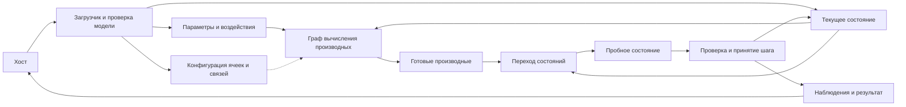

# Архитектура машины состояний

Дата: 2026-10-17. Статус: исследовательское предложение. Первый ограниченный профиль уже реализован и описан в [отдельном документе](11%20Первое%20ядро.md); сравнение производительности ещё не выполнено. Предложения ниже не следует считать перечнем реализованных возможностей. Слово DPU здесь означает предлагаемый процессор динамических систем и не связано с сетевыми процессорами, которые используют то же сокращение.

## 1. Что строим

Машина хранит состояния динамической системы и самостоятельно выполняет их эволюцию. Хост загружает модель, параметры, начальные значения и условия запуска. Внутри одного запуска состояние остаётся в вычислительном ядре на протяжении многих шагов.

Одна синтезированная конфигурация FPGA должна исполнять разные модели. Новая модель меняет содержимое конфигурационной памяти и памяти данных, но не требует синтеза, размещения и трассировки FPGA. Частичная переконфигурация FPGA для смены модели также не является механизмом программирования этой машины.

Базовый архитектурный объект — состояние, имеющее идентификатор, значение, закон производной и правило перехода. Архитектурное действие — завершённый переход системы между моментами модельного времени. Арифметические ячейки реализуют закон производной.

Загрузка графа выражений сама по себе не доказывает полезности архитектуры. Исследование должно показать, какие затраты программируемости остаются и на каких задачах их удаётся окупить.

## 2. Семантика исполнения

Для исходной исследовательской области рассматриваем явную систему:

```text
dx/dt = f(x, u, p, t)

x — состояния;
u — внешние воздействия;
p — параметры;
t — модельное время.
```

У вычисления производных есть версия входных данных — эпоха. Для простого одноэтапного метода эпоха соответствует шагу k. При многоэтапном методе к номеру шага добавляется номер стадии.

В течение эпохи все потребители состояния x_i получают одно и то же значение. Производная не может случайно использовать уже обновлённый x_j того же шага. Физически записи могут происходить в разные такты; доступность новой версии определяется общим событием принятия шага.

Обязательные свойства:

- текущее состояние и пробное следующее состояние различимы;
- значения разных эпох не смешиваются;
- каждое требуемое значение производной вычислено ровно один раз за эпоху;
- завершение производной означает получение всех её вкладов;
- шаг принимается после завершения всех состояний и проверки ошибок;
- при ошибке пробное состояние не становится текущим;
- запуск на N шагов не требует N обращений к хосту.

Это свойства контракта машины. Они не требуют ни конкретного метода интегрирования, ни отдельного физического интегратора для каждого логического состояния.

## 3. Предлагаемое устройство

Первый кандидат — пространственно размещённый граф вычислений с постоянной конфигурацией связей и отдельным механизмом перехода состояний. Пространственное размещение означает, что узлы графа закреплены за физическими ячейками на время запуска.



Загрузчик работает при остановленном ядре. Во время эволюции конфигурация производных остаётся постоянной. Граф может содержать сложение, умножение и другие операции, но ядро не извлекает их по одной из общей памяти команд.

Граф производных внутри одной эпохи ацикличен. Циклы физической системы замыкаются через состояние и границу шага. Например, зависимость dx/dt от y и dy/dt от x допустима: оба значения читаются из одного снимка состояния. Алгебраический цикл без задержки состояния требует отдельного решателя и не поддерживается автоматически.

## 4. Где проходит граница с фон-неймановским исполнением

Различие задаёт механизм работы, а не название команды запуска.

| Свойство | Предлагаемое ядро |
| --- | --- |
| Что задаёт порядок арифметики | Зависимости графа и заранее размещённые связи |
| Где находится операция узла | В постоянной конфигурации его ячейки |
| Что перемещается при вычислении | Значения по настроенным каналам |
| Как задана память состояния | Объектами состояния с назначенными владельцами |
| Как повторяется расчёт | Контроллер эпох снова возбуждает тот же граф |
| Что видит хост | Загрузку системы, запуск эволюции, статус и наблюдения |

Общий счётчик команд, выборка очередных ADD/MUL и общий регистровый файл с произвольными LOAD/STORE в вычислительном тракте не входят в предложение. Если они появятся как основной механизм вычисления производных, от исходной архитектурной гипотезы мы уйдём.

Счётчик шагов, конечный автомат стадий интегрирования и счётчик тактов фиксированного расписания допустимы. Они управляют повторением и согласованием работы графа. Наличие памяти конфигурации также само по себе не делает машину фон-неймановской.

Физический тракт может оказаться близок к CGRA — крупнозернистой реконфигурируемой решётке вычислительных ячеек. Это пересечение нужно признавать. Отличительные обязательства нашего предложения — постоянное владение состояниями, согласованные эпохи, механизм принятия шага и непосредственное исполнение модели системы. Их пользу предстоит измерить относительно более общего графового вычислителя.

## 5. Ячейка состояния

Логическая ячейка содержит:

```text
идентификатор состояния;
текущее значение;
место для пробного значения;
источник готовой производной;
описание численного представления;
признаки готовности и ошибки.
```

Физическая реализация зависит от числа состояний. Для небольшого ядра это могут быть регистры с прямыми выходами в сеть. Для большей вместимости — распределённые банки BRAM, встроенной блочной памяти FPGA, с локальным блоком перехода состояний у каждого банка.

Постоянное место состояния не означает одну общую многопортовую память. Число одновременно читаемых состояний ограничивается реальными портами, репликацией данных или регистрами на выходах банков. Повторное использование состояния несколькими узлами выгоднее обслуживать рассылкой уже прочитанного значения.

Первое измерение должно сравнить регистровый вариант и банки памяти. Выбор BRAM по одному только числу бит может проиграть из-за ограниченного числа портов и цены доставки значений.

Для одноэтапного явного метода достаточно логически двух версий состояния. Во время расчёта текущая версия доступна только для чтения. Результаты перехода записываются в пробную. После проверки все банки синхронно меняют роли. Так частично записанная пробная версия не видна вычислению производных.

При нескольких банках принятие шага — общий сигнал смены версии, подтверждённый всеми банками. При ошибке текущая версия сохраняется, а готовность пробной сбрасывается. Полный откат содержимого памяти для этого не нужен.

## 6. Вычислительные ячейки и сеть

Вычислительная ячейка содержит выбор источников операндов, арифметический блок, выходной регистр и постоянную конфигурацию. Состав операций, разрядность и число ячеек пока не утверждены.

Начальный набор кандидатов: сумма, разность, произведение, умножение на параметр, смена знака и масштабирование. Сравнение и выбор значения нужны для кусочных законов. Деление, корни и тригонометрия требуют отдельной оценки стоимости. Не обещаем поддержку функции, для которой в синтезированном ядре отсутствует реализация.

Операция ячейки фиксируется при загрузке модели. Для смены коэффициента достаточно записи параметра между запусками. Умножение на нулевой или единичный параметр не должно незаметно превращаться в изменение топологии аппаратуры: оптимизация таких случаев допустима в компиляторе графа, но нужно различать структурную константу и изменяемый параметр.

Активная конфигурация небольшого постоянного графа может храниться непосредственно в регистрах выбора операции и входов. Память загружаемого образа используется при активации; чтение описания каждого узла из неё на каждом шаге не требуется. Для более ёмкого ядра стоимость хранения и доставки конфигурации оценивается отдельно.

Полная сеть «каждый выход к каждому входу» удобна для первого мысленного описания, но её площадь растёт примерно квадратично с числом ячеек. Для физического кандидата рассматриваем небольшие группы ячеек с локальной коммутацией и ограниченными связями между группами. Ширина группы и число межгрупповых каналов — параметры исследования.

Компилятор должен размещать узлы и прокладывать связи в уже синтезированной сети. Проверка только числа операций недостаточна: граф может не поместиться по связям при свободных умножителях. Такая модель отклоняется до запуска с указанием причины.

Большое число потребителей одного значения требует дерева рассылки, буферов либо нескольких пересылок. Редукция многих вкладов в одну производную требует дерева сумматоров или локального накопления. Эти затраты учитываются как часть архитектуры.

## 7. Как запускается граф

Для первого пространственного кандидата предпочтительно статическое расписание. Компилятор знает задержки операций, маршрутов и чтения памяти, назначает время получения операндов и вставляет необходимые задержки. Расписание повторяется для каждой эпохи.

Внутри эпохи узлы могут работать параллельно. Результат одного узла идёт прямо в следующие. Узлы с неравной длиной входных путей должны получать операнды одной эпохи: короткий путь дополняется задержкой либо операнды удерживаются в локальных входных регистрах до готовности обоих.

Начальный вариант допускает только одну активную эпоху. Пока шаг не принят, следующий не запускается. Благодаря этому достаточно фиксированных мест для промежуточных значений и признаков готовности; сложная ассоциативная память сопоставления сообщений не нужна.

Рекомендуемый первый протокол:

1. Зафиксировать состояния, параметры, воздействия и шаг времени.
2. Начать эпоху; прежние признаки готовности промежуточных значений недействительны.
3. Подать значения состояний и параметров в граф согласно расписанию.
4. Выполнить граф и получить все выходы производных.
5. Вычислить пробные состояния и собрать признаки ошибок.
6. Дождаться окончания всех записей и опустошения вычислительных конвейеров этой эпохи.
7. Принять шаг общим сигналом либо завершить запуск с ошибкой.

Для производной, тождественно равной нулю, готовность задаётся явно. Отсутствующий вклад не считается нулём по умолчанию.

Если вводим остановку конвейера, она должна согласованно сохранять данные и их признаки готовности на всех затронутых путях. Для первого варианта проще запретить непредусмотренные задержки внутри эпохи: входные данные должны быть доступны заранее, а наблюдения снимаются на границе шага. Если свободного места для обязательного наблюдения нет, ядро ждёт перед запуском следующей эпохи.

Альтернатива — запуск каждого узла по наличию всех входов с локальными признаками готовности. Она облегчает переменные задержки, но добавляет очереди, управление обратным давлением и проверку отсутствия взаимных блокировок. Сравнивать её со статическим вариантом нужно по площади и реальной загрузке ячеек; пока это отдельная гипотеза.

## 8. Связи состояний и граф выражений

Физическая связь часто даёт несколько согласованных вкладов. Например, пружина создаёт противоположные силы на двух телах. Поэтому представление модели должно позволять одному взаимодействию читать несколько состояний и выдавать несколько результатов.

В общем случае удобно разделить:

- граф выражений, вычисляющий общие промежуточные величины;
- сопоставление результатов с производными состояний;
- правила объединения нескольких вкладов в производную.

Это позволяет не вычислять одну и ту же силу или произведение несколько раз. Представление только попарных рёбер между состояниями слишком узко для общего нелинейного закона. Представление только полных независимых формул производных скрывает общие вычисления. Внутреннее представление компилятора должно сохранять обе возможности.

Для первого пространственного варианта редукция раскрывается в явное дерево сумм с определённым порядком округлений. При накоплении в памяти потребуется решить конфликт нескольких записей в одну производную и зависимость чтение–изменение–запись. Двухпортовая память не превращает такое накопление в произвольное число одновременных обновлений.

Оптимизация сохранения парных вкладов полезна, но при независимом округлении обновлений она не гарантирует точного сохранения энергии или импульса. Это проверяется отдельно.

## 9. Пространственное размещение и повторное использование ячеек

Рассматриваем два физических варианта, не смешивая их результаты.

| Вариант | Как работает | Главная цена |
| --- | --- | --- |
| Постоянный пространственный граф | Один узел занимает одну подходящую ячейку; связи неизменны в запуске | Ограниченная вместимость и неполная загрузка ячеек |
| Несколько локальных конфигураций | Ячейка обслуживает несколько заранее назначенных узлов по периодическому расписанию | Память промежуточных значений, контекстов и дополнительные такты |

Первый вариант ближе к аппаратуре под конкретную модель и задаёт исходную проверку стоимости программируемых связей. Он должен поддержать несколько разных графов без смены bitstream; требование разместить любую модель отсутствует.

Второй вариант расширяет вместимость. Его возможная реализация — локальные таблицы конфигураций у групп ячеек и общий номер фазы. Фаза выбирает подготовленный контекст каждой группы; произвольных переходов между арифметическими командами нет. Однако по затратам такая машина приближается к вычислителю с расписанием. Архитектурную пользу сохранения состояний и эпох нужно будет подтвердить повторно.

Переиспользование ячеек требует явно назначить время жизни каждого промежуточного значения, ёмкость локальной памяти, порты и конфликты маршрутов. Оно не является бесплатным расширением первого варианта.

Первый предметный выбор: измерить небольшой постоянный граф и затем добавлять контексты только при доказанной нехватке вместимости. Число ячеек и размер графа выбираются после оценки нескольких моделей и пробного синтеза, а не объявляются заранее.

## 10. Численный метод — отдельный механизм

Контракт вычислителя производных:

```text
подать снимок (x, u, p, t) для заданной эпохи;
получить f(x, u, p, t) и признаки ошибок;
не менять принятые состояния во время вычисления.
```

Такой контракт допускает повторный вызов одного графа на промежуточных состояниях. Например, явный метод средней точки требует:

```text
k1 = f(x, u(t), p, t)
x_mid = x + (dt/2) * k1
k2 = f(x_mid, u(t + dt/2), p, t + dt/2)
x_next = x + dt * k2
```

Для него исходный x должен сохраняться до окончательного перехода; двух буферов, достаточных для простого Эйлера, может оказаться недостаточно без дополнительных регистров или памяти производных. Воздействие на промежуточной стадии тоже должно иметь определённое значение. Контракт оценивает эту потребность заранее.

Эйлер полезен для проверки эпох и загрузки модели, но не назначается окончательным методом. Для незатухающего линейного осциллятора с частотой ω модуль множителя явного Эйлера равен sqrt(1 + (ω dt)^2), то есть превышает единицу при любом ненулевом dt. Рост энергии в таком опыте может быть свойством метода, даже при безошибочной арифметике.

Жёсткие системы могут потребовать очень малого явного шага либо неявного метода с решением системы уравнений. Последнее меняет требования к памяти и вычислительным блокам. Дифференциально-алгебраические уравнения, адаптивный шаг, поиск событий и неявные методы остаются направлениями исследования, их поддержка не следует из поддержки графа f.

Начальная область испытаний — явные ОДУ с фиксированным шагом и известными требованиями к точности. Для каждого испытания метод и dt записываются вместе с результатом. Более широкий класс физических задач, включая CFD, нельзя заявлять по результатам нескольких малых ОДУ.

## 11. Численное представление

Выбор между фиксированной точкой и плавающей точкой пока открыт. В первом случае понадобятся масштабы состояний и промежуточных величин; во втором — оценка площади, задержек и поведения особых значений.

Каждый поддерживаемый арифметический профиль должен определять:

- разрядность операндов, произведения, суммы и результата;
- позиции округлений и правило округления;
- представление dt и параметров;
- допустимый диапазон масштабирования;
- обработку переполнения, деления на ноль и других ошибок;
- порядок суммирования вкладов;
- поведение при слишком малом приращении состояния.

При фиксированной точке dt * dx может округлиться до нуля, хотя производная ненулевая. Следует сравнить более широкое хранилище интегратора, накопление остатка и прямое округление. Отдельные защитные разряды сумматора не решают все ошибки интегрирования.

Предлагаемое исходное поведение при недопустимом переполнении — остановка до принятия пробного шага. Насыщение допустимо как явно объявленная семантика модели или профиля. Молчаливое насыщение способно изменить саму динамику системы.

Один неизменный bitstream может поддерживать несколько масштабов, если соответствующие сдвиги реализованы заранее. Произвольная смена аппаратной разрядности и появление новых арифметических функций загрузкой модели невозможны. Файл модели должен требовать конкретный совместимый профиль ядра.

## 12. Что загружаем вместо программы CPU

Предлагаемый образ модели содержит следующие разделы. Это логическая схема, не утверждённый двоичный формат и не окончательная ISA — система команд.

| Раздел | Содержимое |
| --- | --- |
| Требования | Версия формата, профиль арифметики, ёмкости и необходимые операции |
| Состояния | Идентификаторы, начальные значения, представление и назначения |
| Параметры | Значения и допустимые точки обновления |
| Выражения | Узлы, зависимости и общие промежуточные величины |
| Производные | Выходы графа и состав вкладов для каждого состояния |
| Размещение | Физические ячейки, маршруты, задержки и локальные назначения памяти |
| Переход | Поддерживаемый метод, dt и условия завершения |
| Воздействия | Источники, таблицы или поддерживаемые генераторы |
| Наблюдения | Выбранные состояния, период и политика заполнения буфера |

Компилятор на хосте преобразует описание уравнений в этот образ. Он проверяет граф, размещает его в фиксированном ядре, рассчитывает расписание и выпускает отчёт об использованных ресурсах. Это компиляция модели без вызова средств синтеза FPGA.

Проверки до активации: совместимость профиля, допустимые идентификаторы и операции, наличие всех производных, отсутствие алгебраических циклов, маршрутизация всех связей, ёмкость буферов, соблюдение числа портов и задержек.

Простые проверки диапазонов, длины и контрольной суммы образа повторяет аппаратный загрузчик. Полную математическую корректность расписания в первом прототипе подтверждает компилятор; граница доверия к нему должна быть указана явно. Защита от повреждённого файла не равна доказательству правильности графа.

## 13. Управление и наблюдения

Предварительные действия хоста: загрузить модель, активировать проверенную конфигурацию, задать начальное состояние, запустить N шагов, остановиться на границе шага, прочитать снимок и диагностику.

Во время запуска конфигурация, dt и параметры неизменны. Для первого варианта их изменение выполняется после остановки на границе шага. Позже можно добавить заранее загруженные изменения, привязанные к номеру шага. Независимые записи хоста посреди вычисления производных нарушили бы согласованность эпохи.

Внешние воздействия должны быть доступны внутри ядра: постоянное значение, таблица по времени либо заранее поддерживаемый генератор. Если применяется удержание значения на протяжении шага, это часть численной модели. Поток нового управления с CPU на каждом шаге является отдельным режимом с отдельным учётом задержек.

Наблюдения снимаются с принятого состояния. Для первого варианта обязательная запись при заполнении буфера останавливает ядро перед следующим шагом и сохраняет последний принятый снимок. Режим пропуска наблюдений с явным счётчиком потерь можно добавить отдельно. Финальное состояние доступно независимо от полноты трассы.

Транспорт загрузки не определяет вычислительную архитектуру. В моделировании достаточно интерфейса чтения и записи конфигурации и данных. Позднее можно подключить PS Zynq через AXI либо другой подтверждённый интерфейс платы. AXI, выводы, тактовый источник и программное окружение PS сейчас не утверждаются.

Модельное время и физическое время различаются. Быстрый автономный расчёт не означает работу с внешним устройством в реальном времени. Для такого режима позже потребуются подтверждённые сроки завершения шага, синхронизация ввода и вывода и поведение при пропуске срока.

## 14. Как разные модели попадают в одно ядро

### Лоренц

```text
dx = sigma * (y - x)
dy = rho * x - y - x * z
dz = x * y - beta * z
```

Один снимок x, y, z рассылкой подаётся в несколько ветвей. Параметры sigma, rho, beta загружаются как данные. Три выхода назначаются производным трёх состояний. Между ветвями нет обновления состояния.

Проверка: смена параметров и затем смена самой топологии модели без нового bitstream. Долгое поточечное совпадение хаотических траекторий не является единственным критерием: нужны ошибка короткой траектории относительно эталона и заранее выбранные характеристики длительного расчёта.

Конкретный пример размещения показан ниже. Это учебный граф на пяти умножителях и четырёх вычитателях, а не выбранный размер ядра. Пусть умножение занимает два такта, вычитание — один, источники уже доступны, а задержки маршрутов пока равны нулю.

| Ячейка | Постоянная функция в этой модели | Готовность от начала эпохи |
| --- | --- | --- |
| A0 | y - x | 1 |
| M0 | sigma * A0 | 3 |
| M1 | rho * x | 2 |
| M2 | x * z | 2 |
| A1 | M1 - y | 3 |
| A2 | A1 - M2 | 4 |
| M3 | x * y | 2 |
| M4 | beta * z | 2 |
| A3 | M3 - M4 | 3 |

В этой конфигурации выходы M0, A2 и A3 назначены производным x, y и z. Для A2 результат M2 удерживается до прихода A1. Если выходы принимаются одновременно, M0 и A3 задерживаются ещё на один такт. Чтение состояния, реальные маршруты и переход состояния добавят свои задержки.

На каждом шаге содержимое настроек A0…A3 и M0…M4 сохраняется. Контроллер подаёт новый снимок состояний, затем ждёт завершения эпохи. Общей выборки девяти арифметических команд в этом примере нет.

### Последовательная RLC-цепь

Для состояния (i, v_c):

```text
di = (v_in - R * i - v_c) * inv_L
dv_c = i * inv_C
```

При постоянных L и C обратные величины вычисляются при подготовке модели. Это устраняет аппаратное деление для данной формы уравнений, но не обеспечивает деление на произвольное изменяемое состояние.

Проверка: затухание, стационарный режим, чувствительность к dt и формату числа. Для гармонического воздействия нужен поддерживаемый генератор или загруженная таблица с определённым правилом интерполяции.

Те же пять умножителей и четыре вычитателя из примера Лоренца по числу операций достаточны для следующего назначения: M0 = R * i, A0 = v_in - M0, A1 = A0 - v_c, M1 = A1 * inv_L, M2 = i * inv_C. Выходы M1 и M2 теперь назначены двум другим состояниям; остальные ячейки не используются. Меняются конфигурация входов, маршруты, параметры и назначения выходов. Проверка вместимости сети всё равно обязательна: достаточное число ячеек не гарантирует допустимых связей.

### Тепловая сеть или цепочка масс и пружин

Здесь проверяются общие взаимодействия, рассылка, редукции и рост числа состояний. Для тепловой сети с постоянными ёмкостями:

```text
q_ij = g_ij * (T_j - T_i)
dT_i = (Q_i + sum(q_ij)) * inv_C_i
```

Знак вклада в соседнее тело и границы сети задаются явно. Этот класс нужен, чтобы исследование не ограничилось двумя маленькими графами.

### PMSM

Модель синхронного двигателя с постоянными магнитами проверяет связанные электрические и механические состояния, разные масштабы величин и внешнее управление. В зависимости от координат и границ модели потребуются тригонометрия и преобразования координат. Сначала фиксируем конкретные уравнения и необходимые функции; только затем оцениваем, поддерживает ли их тот же профиль ядра.

Поддержка Лоренца и RLC не считается доказательством поддержки PMSM. При отсутствии нужной функции образ должен отклоняться, а не требовать отдельной прошивки незаметно для испытания.

## 15. Где может появиться выигрыш

Рабочие гипотезы: длительное хранение состояния рядом с вычислениями, одновременное исполнение независимых ветвей, повторное использование размещённых связей, передача общих результатов без общего регистрового файла и отсутствие центральной выдачи арифметических команд.

Потенциальные потери: программируемая коммутация, низкая загрузка пространственных ячеек, балансировка путей, ограниченное число портов памяти, редукции, несколько стадий метода, а также более низкая частота и недостаточный параллелизм маленькой модели.

Рассчитывать следующий шаг одной системы до получения необходимых состояний предыдущего в общем случае нельзя. Конвейер арифметики с приёмом новых операндов каждый такт не гарантирует новый шаг той же системы каждый такт. Несколько независимых экземпляров модели могут загрузить такой конвейер, но их пропускная способность учитывается отдельно от задержки одной траектории.

Для оценки обозначим:

```text
L_f — задержка критического пути вычисления производных с памятью и маршрутами;
L_u — задержка перехода состояния;
L_b — задержка проверки и принятия шага;
q — число вычислений f на шаг;
P — число подходящих арифметических ячеек;
O — число операций на эпоху;
R — число передач через ограничивающий канал;
B — пропускная способность этого канала, передач за такт.
```

Для одноэтапного кандидата, который сначала получает все производные и затем обновляет состояния:

```text
C_step >= L_f + L_u + L_b
```

Для повторного использования одинаковых по производительности ячеек дополнительные грубые границы на эпоху:

```text
C_epoch >= ceil(O / P)
C_epoch >= ceil(R / B)
```

Это нижние оценки, а не прогноз частоты или производительности. Для разных типов операций границы считаются отдельно; зависимости накопления и конфликты банков могут сделать результат хуже. Для многоэтапного метода требуется учитывать все q вычислений f и промежуточные переходы.

Честная мера — время достижения заданного модельного времени при заданной ошибке. Число шагов в секунду при разных методах и точности недостаточно. Нужны также задержка одной траектории, пропускная способность нескольких независимых траекторий и размер поддерживаемой модели.

## 16. Ограничения XC7Z020

Целевой кристалл остаётся xc7z020clg400-1. По таблице ресурсов AMD он имеет 53 200 LUT, 106 400 триггеров, 140 блоков BRAM по 36 Кбит и 220 DSP-блоков. Это полный ресурс кристалла, а не бюджет доступных вычислительных ячеек. Источник: [DS190, таблица 1](https://docs.amd.com/api/khub/documents/juMnxca71Tf2gfjmNyjM8A/content).

DSP48E1 имеет аппаратный умножитель 25 × 18 бит и 48-разрядный арифметический тракт; стоимость более широкой или плавающей арифметики нельзя считать как один DSP на узел. Источник: [UG479](https://docs.amd.com/v/u/en-US/ug479_7Series_DSP48E1).

Вместимость BRAM не равна произвольному числу портов. Реализация банков, режимов чтения и записи и задержек должна следовать [UG473](https://docs.amd.com/v/u/en-US/ug473_7Series_Memory_Resources). Конфигурация сети, задержки путей и промежуточные значения тоже расходуют память и логику.

Сначала считаем отдельно состояния, производные, промежуточные значения, конфигурацию, маршруты, входные таблицы и наблюдения. После пробного синтеза проверяем фактическое использование BRAM, DSP, LUT, триггеров и достижимую частоту. Расчёт только объёма состояния будет слишком оптимистичен.

DDR и PS не требуются для первого моделируемого ядра. Их включение позже рассматривается как отдельный этап; размещение состояния во внешней памяти изменит оценку задержек и обмена.

## 17. Что уже решено и что проверяем

Зафиксированы требования: одна аппаратная конфигурация для нескольких моделей, состояние внутри ядра между шагами, отсутствие центральной выборки арифметических команд как основы исполнения, согласованное принятие шага и явные ограничения поддерживаемых моделей. Эти требования отражены в журнале решений.

Исследовательский кандидат: постоянный пространственный граф, статическое расписание и одна активная эпоха. Его нужно сначала проверить на моделях и оценке ресурсов.

Открыты: число и типы ячеек, топология сети, регистры или банки состояния, формат числа, метод интегрирования, число стадий, набор нелинейных функций, локальные контексты, интерфейс хоста и формат образа модели.

## 18. Связанные работы и пределы выводов

Постоянные графы, запуск по готовности операндов и разделение статического и динамического исполнения рассматриваются в работе Arvind и David E. Culler [Dataflow Architectures](https://dspace.mit.edu/entities/publication/db53bf88-50f7-4457-a9a3-f7828b2ae34f). Это историческая основа механизмов исполнения; специализированный контракт состояния и эпох здесь является нашим предложением.

Программируемый вычислительный слой поверх FPGA обычно называется overlay — аппаратная структура, в которую загружают конфигурацию без повторного синтеза FPGA. Работа Li и соавторов [An Area-Efficient FPGA Overlay using DSP Block based Time-multiplexed Functional Units](https://arxiv.org/abs/1606.06460) исследует повторное использование функциональных блоков по времени. Она помогает сформулировать компромисс площади и пространственного параллелизма, но не доказывает выигрыш нашей машины на ОДУ.

Постоянная сеть функциональных блоков и потоковые связи также исследуются Wang и соавторами в [Addressing Architectural Obstacles for Overlay with Stream Network Abstraction](https://arxiv.org/abs/2411.17966). Область их испытаний — нейросетевые вычисления; перенос результатов ускорения на динамические системы неправомерен.

Эти источники подтверждают существование родственных подходов. Новизну конкретного решения и сравнение с программируемыми цифровыми дифференциальными анализаторами и ускорителями ОДУ ещё предстоит изучить отдельно. Численных обещаний ускорения сейчас нет.
