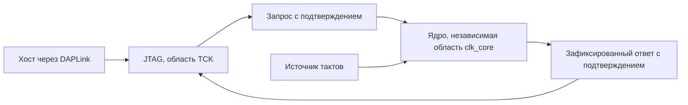

# Тактирование и ограничения первого образца

Дата: 2026-10-17. Исторический разбор первого сравнения с M1. Описания RTL ниже относятся к первому образцу. Изменения уже реализуются во [втором ядре](14%20Второе%20ядро.md): независимый генератор и исправленные DSP проверены отдельной диагностикой, полное новое ядро ещё ожидает аппаратной проверки.

## Почему ядро оказалось на TCK

В `rtl/top.sv` выход `BSCANE2.TCK` проходит через BUFG и тактирует как JTAG, так и вычислительное ядро. Это было временным решением для запуска через имеющийся DAPLink: отдельный вывод генератора PL не подтверждён, а настройка PS не выполнялась. Общая частота также позволила сначала проверить протокол без передачи данных между разными тактовыми областями.

Такой режим пригоден для функционального испытания. Для сравнения производительности следовало сначала отделить вычислительное тактирование. Нынешние результаты описывают отладочный образец, а не достигнутую производительность архитектуры после аппаратной оптимизации. Численные измерения CPU и счётчиков FPGA остаются действительными.

При остановке TCK ядро останавливается. Настройка адаптера на 1 МГц задаёт скорость выдаваемых импульсов; паузы между пакетами USB не исчезают. Поэтому реальная выдача пакета из приблизительно тысячи импульсов занимает десятки миллисекунд. Удаление платы из обмена с хостом на каждом шаге уже выполнено, но самостоятельного хода времени внутри ядра пока нет.

## Что ограничено в самом RTL

| Наблюдение по исходникам | Следствие |
| --- | --- |
| 9 универсальных узлов имеют по полному умножителю 32×32 | Даже узел, загруженный суммой, физически содержит возможность произведения |
| Ещё 4 полных умножителя используются для `dt * derivative` | Всего предусмотрено 13 широких умножителей |
| `-nodsp` отключает DSP; частичные произведения и их объединение размещаются в обычной логике | Получен дорогой тракт: 40099 LUT после синтеза, без использования аппаратных умножителей |
| Выбор источников, полное произведение и проверка диапазона между регистрами не разбиты на стадии | Большая комбинационная задержка; для высокой частоты нужна отдельная работа с трактом |
| Выбор значений через общую шину допускает все источники, хотя проверка графа запрещает часть связей | Аппаратура выбора шире множества допустимых зависимостей конкретного узла |
| `all_ready` проверяет прежние регистры готовности, затем выполняется отдельный COMMIT | Поверх глубины графа добавлены такт распознавания готовности и такт перехода состояния |
| Ограничение сборки задано на 1 МГц | Схема не проходила целенаправленную оптимизацию под более высокую рабочую частоту |

Оценка nextpnr 24.15 МГц относится к этому размещению при ограничении 1 МГц. Она не является измеренной частотой и не устанавливает предел кристалла или будущей реализации. В сохранённом отчёте `critical_paths` пуст; точный худший путь перед оптимизацией ещё нужно получить из средства размещения либо контрольной сборки Vivado. Перечисленные комбинационные цепочки видны в RTL, но их ранжирование по задержке пока не доказано.

Отключение DSP обошло реальное аппаратное расхождение арифметики. Оно позволило проверить семантику, но не является законченным решением для производительности. Два неудачных варианта не доказывают, что DSP непригодны; причина расхождения остаётся открытой.

## Как разложить полученное отставание

Для одной и той же схемы без изменения числа тактов:

| Модель | На 1 МГц, нс/шаг | Условно на 24.15 МГц, нс/шаг | Измеренный C, нс/шаг | Условное отставание на 24.15 МГц |
| --- | --- | --- | --- | --- |
| Лоренц | 5000 | 207 | 10.47 | 19.8 раза |
| RLC | 6000 | 248 | 8.50 | 29.2 раза |
| Тепловая цепочка | 5000 | 207 | 10.26 | 20.2 раза |
| Осциллятор | 3000 | 124 | 3.72 | 33.4 раза |

Второй столбец вычислен по счётчику и настроенной частоте, третий — экстраполяция оценки средства. Ни один из них не включает паузы USB. Переход с 1 на 24.15 МГц арифметически даёт 24.15 раза; это объясняет существенную часть разрыва 477–806 раз. Остаток требует изменения реализации либо класса задачи. Обещать равенство с M1 после одной смены генератора оснований нет.

Четыре состояния и несколько операций дают CPU очень малую рабочую задачу. Для связанной траектории каждый следующий шаг зависит от предыдущего; заполнение длинного конвейера не уменьшает автоматически задержку этой обратной связи. При разбиении умножения на стадии сравнивать следует полное время шага, а не одну лишь частоту. Пропускная способность для нескольких независимых траекторий — отдельный опыт.

## Независимое тактирование

Следующее устройство интерфейса:

JTAG передаёт конфигурацию, начальные состояния и RUN. После принятия RUN ядро выполняет шаги при полной остановке TCK. Ответы и результаты сохраняются до чтения хостом. Медленная загрузка через JTAG может остаться на этом этапе: она не должна управлять ходом расчёта.

### Источник тактов

Предпочтительный кандидат на этой плате — `FCLK_CLK0` процессорной системы Zynq. PS имеет четыре выхода тактов в PL, получаемых от выбираемых PLL; их можно подать в глобальные буферы PL. Это штатный путь, описанный в [AMD UG585, PL Clocks](https://docs.amd.com/r/en-US/ug585-zynq-7000-SoC-TRM/PL-Clocks) и [UG925, раздел PL Clocks](https://docs.amd.com/api/khub/documents/2a9d9zSiOIPblrbKQNtrcg/content). Использование PS как источника частоты не переносит туда расчёт уравнений.

Для платы подтверждён генератор 33.3333 МГц на входе PS_CLK. Это не подтверждение отдельного тактового входа PL. См. раздел 2.2.3 и схему Y1 в [руководстве QMTECH, копия исходного PDF](https://device.report/m/cdee2e825a905c5a46a9499bb0406e1fdd81f5e0eb1e66ed24fc5ef06fd9c084.pdf). Настройка выходной частоты FCLK требует учесть текущее состояние PS и подключить соответствующий выход в аппаратном проекте; одного нового ограничения XDC недостаточно.

Другой документированный источник — внутренний генератор конфигурации через `STARTUPE2.CFGMCLK`, без нового вывода платы: [AMD UG953, STARTUPE2](https://docs.amd.com/r/2022.2-English/ug953-vivado-7series-libraries/STARTUPE2). Его можно отдельно исследовать для доказательства автономности. Номинальная частота внутреннего генератора не заменяет её измерение; использовать её как точную опору сравнения без проверки нельзя. Поддержка маршрута текущими средствами openXC7 здесь ещё не проверена.

Подключённый к подтверждённому тактовому выводу внешний генератор тоже возможен. Назначения такого вывода в репозитории пока нет.

В этом разборе PS не опрашивался и не перенастраивался, прошивка PL не менялась. Имеющееся разрешение на записи в наше ядро и временную PL не распространяется автоматически на изменение регистров тактирования PS; правило AGENTS.md требует отдельного явного разрешения для такой записи. Выбор конкретных регистров и значений должен быть подготовлен до запроса разрешения.

### Передача между тактовыми областями

Нужен CDC — корректный переход между независимыми тактовыми областями. Для первого интерфейса достаточно одного ожидающего запроса с подтверждением:

1. Область TCK фиксирует весь запрос и удерживает его до подтверждения.
2. Признак нового запроса передаётся через цепочку синхронизации в `clk_core`.
3. Ядро принимает устойчивый пакет ровно один раз, исполняет управление и фиксирует ответ.
4. Признак готовности ответа передаётся обратно; ответ удерживается до его приёма.
5. Новый запрос допускается после завершения предыдущего обмена. Это ограничение интерфейса не останавливает автономный RUN.

Нельзя независимо синхронизировать каждый бит 64-разрядного запроса: можно получить смесь разных пакетов. Передаются удерживаемые данные с подтверждением либо используется асинхронная очередь. Нужны атрибуты синхронизаторов, ограничения межтактовых путей и проверка задержки удерживаемого пакета. Сброс и повторное подключение TCK должны иметь определённые правила, исключающие повтор команды.

Нынешнее правило «четыре TCK после UPDATE» и расчёт ожидания как `N * тактов_на_шаг` перестают быть основой протокола. Хост должен различать готовность ответа управления и завершение расчёта; нужны опрос с предельным временем и явное описание версии протокола. Согласованный снимок состояний читается после завершения либо фиксируется отдельным действием.

## Порядок исправления

1. Подтвердить и подготовить независимый источник тактов и его ограничения. Начальная частота выбирается по текущему тракту; частота 100 МГц не объявляется рабочей без реализации и проверки.
2. Отделить JTAG от ядра, ввести подтверждаемый обмен между областями и синхронное снятие сброса в каждой области.
3. В моделировании запускать расчёт, полностью останавливать TCK и проверять продолжение и завершение. Повторить с разными отношениями частот, сдвигами фаз и восстановлением обмена.
4. На плате доказать исполнение при отсутствии TCK: выбрать запуск, который не успеет закончиться во время передачи команды, затем проверить продвижение за интервал без импульсов JTAG. Короткий расчёт, завершившийся ещё при передаче RUN, такого доказательства не даёт.
5. Получить худшие пути, проверить отдельный умножитель DSP с регистровыми границами на плате, затем выбрать разбиение вычислительных узлов на стадии. Зафиксировать задержки в модели готовности.
6. Оценить сокращение разрешённых входов каждого узла, разделение типов ячеек и устранение лишнего такта распознавания готовности. Общая запись состояния и правила переполнения должны сохраниться.
7. Повторить функциональные проверки и сравнение с C при измеренной частоте и без участия JTAG внутри интервала расчёта. Расширение графа выполнять после оценки площади и связей.

Постоянная конфигурация графа, собственное состояние и согласованное принятие шага сохраняются. Центральная выборка арифметических команд для этого исправления не требуется.
